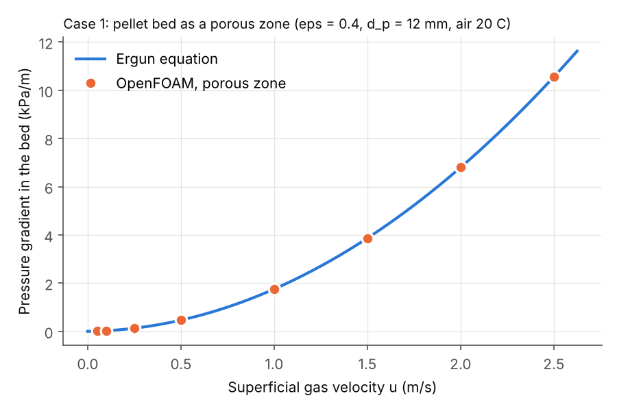
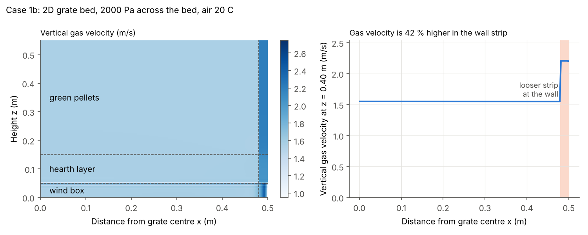
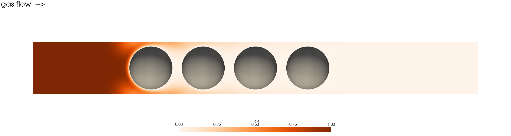
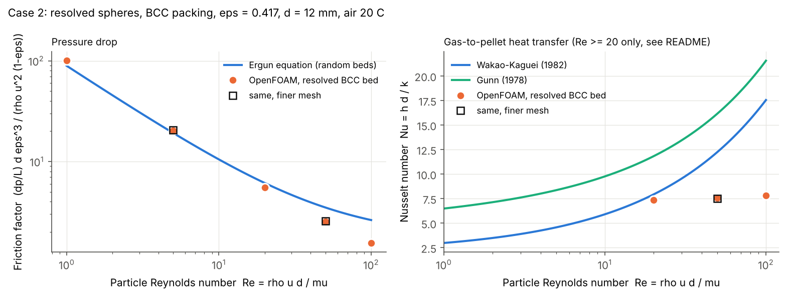

# Gas flow and heat transfer in a packed bed of pellets (OpenFOAM)

A small, fully reproducible CFD study of air flowing through a bed of
spherical pellets, like the bed on a travelling-grate induration machine.
I built it to learn OpenFOAM and to connect it with my own gas–solid models,
which use the Ergun equation for the pressure drop.

It has three parts:

| Case | What it does | Main result |
|---|---|---|
| 1. Porous zone | The bed is a porous region with an Ergun-based (Darcy–Forchheimer) resistance. 1D column, 8 gas velocities. | Pressure drop equals Ergun (difference below 0.001 %). This verifies the set-up. |
| 1b. Wall channelling | 2D slice of a grate bed: wind box, hearth layer, green pellets, and a looser strip next to the side wall. | Gas is about 42 % faster in the wall strip. |
| 2. Resolved pellets | Each pellet is meshed (snappyHexMesh), BCC packing, porosity 0.417, Re = 1 to 100. Pressure drop and gas-to-pellet heat transfer. | Within 13 % of Ergun up to Re = 20, lower at higher Re (0.59 of Ergun at Re = 100). Nu about 7.5, roughly constant for Re 20 to 100. |

Everything runs with the free OpenFOAM v1912 package on Ubuntu or on Windows
through WSL. A full run of all cases takes about one hour on 4 CPU cores.
See [LEARNING_GUIDE.md](LEARNING_GUIDE.md) for a step-by-step explanation of
every choice.

---

## Case 1: the bed as a porous zone

The momentum equation gets a sink term in the bed:

    S = -( mu * d + 0.5 * rho * |U| * f ) * U

With `d = 150 (1-eps)^2 / (eps^3 dp^2)` and `f = 3.5 (1-eps) / (eps^3 dp)` this
is exactly the Ergun equation. Bed: 0.5 m high, eps = 0.40, dp = 12 mm, air
at 20 °C, superficial velocity 0.05 to 2.5 m/s. Solver: `porousSimpleFoam`.



The match is exact, as it should be: this case checks that the coefficients,
the units (kinematic pressure, superficial velocity) and the solver settings
are right. It is a verification, not a validation. The same coefficients go
into ANSYS Fluent as viscous resistance `1/alpha = d` and inertial resistance
`C2 = f`.

## Case 1b: wall channelling in a 2D grate bed



Half of a 1 m wide grate (symmetry at the centre line), 2000 Pa from the wind
box to the top of the bed. Hearth layer: eps = 0.40, dp = 14 mm. Green
pellets: eps = 0.40, dp = 12 mm. A 2 cm strip at the side wall: eps = 0.48.
The strip is 4 % of the width but carries 5.6 % of the gas. The strip values
are assumed for illustration; they are not measured.

## Case 2: resolved pellets

The pellets (12 mm spheres) sit in a body-centred cubic (BCC) lattice. Only a
quarter of one lattice column is meshed, with symmetry planes on the sides.
Spheres are shrunk to 95 % of the touching size so that the mesh does not have
to resolve point contacts. Mesh: `blockMesh` + `snappyHexMesh`, about 93 000
cells for a 4-period bed; the meshed fluid volume matches the exact geometry
within 0.02 %. Solvers: `simpleFoam` (steady laminar flow), then
`scalarTransportFoam` for the temperature in the frozen flow (gas in at T = 1,
pellet surfaces at T = 0, Pr = 0.71).




*Re = 50, plane through the middle of the column. Gas flows from left to right.*

Entrance and exit effects are removed by running a 2-period and a 4-period
bed and using only the difference between them.



| Re | dp/L OpenFOAM (Pa/m) | dp/L Ergun (Pa/m) | OpenFOAM / Ergun | Nu OpenFOAM | Nu Wakao–Kaguei | Nu Gunn |
|---:|---:|---:|---:|---:|---:|---:|
| 1 | 0.129 | 0.115 | 1.12 | not valid (see below) | 3.0 | 6.5 |
| 5 | 0.657 | 0.62 | 1.06 | not valid (see below) | 4.6 | 8.4 |
| 20 | 2.84 | 3.16 | 0.90 | 7.4 | 7.9 | 11.8 |
| 50 | 8.21 | 11.3 | 0.73 | 7.6 | 12.3 | 16.2 |
| 100 | 20 | 33.8 | 0.59 | 7.8 | 17.6 | 21.6 |

**Mesh check.** I repeated Re = 5 and Re = 50 on a finer mesh (cells half the size at the pellet surface, about 365 000 cells instead of 93 000). The pressure gradient changed by 1.3 % and 0.9 %, and Nu at Re = 50 by 0.8 %. Max mesh non-orthogonality is 38 degrees and checkMesh reports "Mesh OK".

**What the results say.**
- At low Re the resolved pressure drop is close to Ergun. As Re grows it
  falls below Ergun (0.59 of Ergun at Re = 100). The ordered BCC bed, aligned
  with the flow, gives straighter gas paths and less form drag than the random
  beds that Ergun's constants come from. The 95 % shrink also opens the
  contacts.
- The Nusselt number is about 7.5 and almost independent of Re between 20 and
  100. This looks like the fully developed heat transfer of laminar flow in
  channels. In a random bed the gas is mixed sideways by the random geometry,
  which is one likely reason why the correlations give higher values that
  grow with Re. I have not proven this cause.
- Below Re of about 20 the gas reaches the pellet temperature within one layer
  and axial conduction matters, so the simple way I extract h is not valid
  there. The plot shows heat transfer only for Re >= 20.

## Limits (read before using the numbers)

- Cold air with constant properties. No radiation, no reactions, no heat
  conduction inside the pellets (their surface temperature is fixed).
- Laminar and steady (Re <= 100). Real induration beds run at higher Re,
  where the flow between pellets is unsteady.
- An ordered BCC packing of identical spheres, not a random packing of real
  pellets.
- Single runs on one machine. The mesh check covers two Re values.

## How to run

```bash
sudo apt install openfoam python3-numpy python3-matplotlib   # Ubuntu 24.04 or WSL
source /usr/share/openfoam/etc/bashrc
./Allrun                       # all cases, about 1 hour on 4 cores
```

Or one case at a time:

```bash
cd case1_porous_ergun && python3 run_sweep.py && python3 plot_case1.py
bash case1b_wall_channelling/Allrun
cd case2_resolved_bed && python3 run_study.py && python3 analyse_case2.py
python3 render_case2.py        # optional 3D pictures, needs: pip install pyvista
```

The OpenFOAM function objects (`functions {}` and `postProcess -func`) do not
work in the Ubuntu v1912 package (an error about "sha1"), so all
post-processing reads the OpenFOAM result files directly in Python.

## Files

```
case1_porous_ergun/       0/, constant/, system/ + run_sweep.py, plot_case1.py
case1b_wall_channelling/  0/, constant/, system/ + Allrun, plot_case1b.py
case2_resolved_bed/       make_case.py (writes a full case), run_study.py,
                          analyse_case2.py, render_case2.py, results/
plots/                    all figures
LEARNING_GUIDE.md         step-by-step explanation and interview notes
```

## References

- S. Ergun, Fluid flow through packed columns, Chem. Eng. Prog. 48 (1952) 89–94.
- N. Wakao, S. Kaguei, Heat and Mass Transfer in Packed Beds, Gordon and Breach, 1982.
- D. J. Gunn, Transfer of heat or mass to particles in fixed and fluidised beds, Int. J. Heat Mass Transfer 21 (1978) 467–476.
- OpenFOAM v1912, ESI-OpenCFD, https://www.openfoam.com

## Licence

MIT, see [LICENSE](LICENSE). Author: Mohamad Hosein Hemasian Etefagh.
